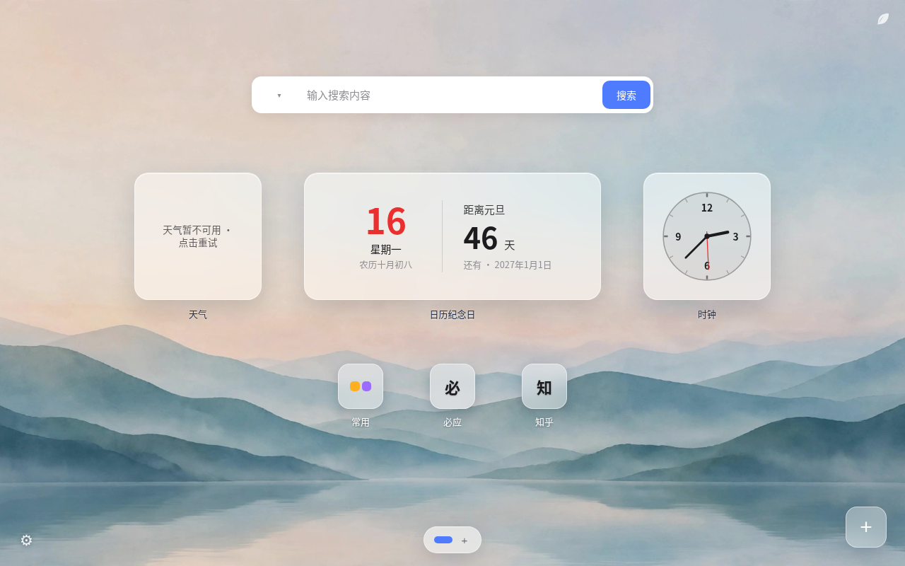

# 新屿 NewIsle

**本地优先的新标签页工作台** — 多桌面、毛玻璃组件、多引擎搜索与高清壁纸。无账号、无追踪，所有数据只存在你自己的浏览器里。

A local-first new tab page with multiple desktops, frosted-glass widgets, multi-engine search, and beautiful wallpapers. No accounts, no tracking — your data never leaves your browser.

## 安装 / Install

- **Firefox**：[addons.mozilla.org/firefox/addon/newisle](https://addons.mozilla.org/firefox/addon/newisle/)（审核中，通过后即可一键安装）
- **Chrome / Edge**：商店上架进行中；也可下载本仓库 [v2.20.0 标签](../../releases/tag/v2.20.0) 的 Source code (zip)，解压后在扩展管理页开启「开发者模式」→「加载已解压的扩展程序」手动安装（仓库根目录即扩展根目录）。

## 功能 / Features

- **多桌面** — 底部圆点切换、独立布局与壁纸、可锁定、可设默认桌面；网格与自由（拖放/吸附/缩放）两种布局
- **毛玻璃组件** — 时钟（模拟/数字）、天气与预报、日历纪念日（农历/节气/法定假日）、待办、便签、番茄钟、世界时钟、计算器、单位换算、倒计时、习惯打卡、汇率、历史上的今天、新闻 RSS、热搜
- **快捷方式** — 图标与两级文件夹（拖拽整理）、内置品牌图标库、自定义图标、一键导入浏览器书签
- **搜索** — 多引擎切换、搜索历史、可选搜索建议（默认关）
- **壁纸与外观** — 内置高清壁纸、图库 API（含必应每日一图、NASA 每日天文图等 JSON 图源）、本地上传；自动轮换可全部随机或指定单一图源；主题保存、极简模式、深色模式、中英双语
- **数据** — 导出/导入完整备份（JSON/ZIP，含壁纸图片）、自动快照与回收站

## 隐私 / Privacy

无服务器、无统计、无广告 SDK。布局、图标、设置与壁纸图片全部存于浏览器本地（localStorage / IndexedDB）。天气自动定位、搜索建议等联网功能默认关闭，仅在你主动开启后直达对应的第三方接口，开发者不经手任何数据。详见 `manifest.json` 的 `data_collection_permissions` 申报。

## 技术 / Tech

原生 JavaScript + MV3，零依赖、零构建、无远程代码、无 eval（计算器为手写解析器）。同一套代码运行于 Firefox / Chrome / Edge。

## 许可 / License

Copyright © 2026 macen0563. All Rights Reserved.
